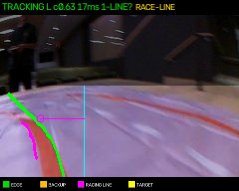
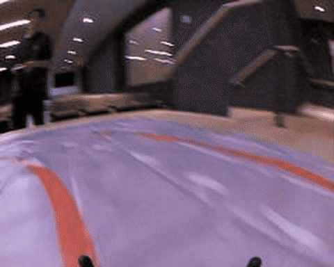

# PiRacer Pro Autonomous Racer



An autonomous racing system for the Waveshare PiRacer Pro. It sees the orange race track through one fisheye camera, estimates track geometry, plans a moving Racing Line, and drives laps with pure pursuit, PD correction, speed planning, and safety guards.

> This project is about the physical car first. The simulator is a complimentary engineering tool: we knew it was overbuilt for the time available, but we had less than a week, busy schedules, and very limited access to the car. Real driving results are the authority; simulation helps us reason about changes when the car is not available.

## Current status

- **Primary controller:** Racing Line + pure pursuit + light PD correction.
- **Hardware:** Waveshare PiRacer Pro, Raspberry Pi, fisheye camera, orange-track race mat.
- **Best documented real run:** about 3.05 s/lap over an independent clean 9-lap timing window.
- **Simulation:** useful for regression and controller comparisons, not a substitute for physical validation.
- **Status:** active race project; camera, battery, grip, and steering calibration still affect results.

## Controller progression and lap times

The project evolved in three stages. The numbers below are deliberately labeled: the simulator was built for repeatable engineering checks, while physical laps are the result that matters.

| Stage | Physical result | Supplementary simulator result | What changed |
|---|---|---|---|
| **PD baseline** | — | **8.40 s/lap** for the Nov 9, 9:31 pm setup; an earlier setup recorded 7.35 s/lap | Reacted to tape position at one image row using proportional and derivative correction. |
| **Pure pursuit / fixed-offset Race** | **3.68 s/lap mean**, 0 line losses in the first corrected-camera Race run; a later fresh-battery Race run averaged **3.59 s/lap over 10 laps** | **3.68 s/lap nominal**, with all 21 tested variations passing in the documented comparison | Projected the visible boundary onto the ground and steered toward a point ahead on a ride line. |
| **Racing Line + pure pursuit** | **About 3.05 s/lap mean** over an independent clean 9-lap timing window; an earlier 10-lap run averaged **3.57 s/lap** with one line loss | **3.50 s/lap** for the documented 1.00/0.90 profile; results depend strongly on the simulated speed and grip assumptions | Replaced the mostly fixed ride line with a path that prepares for the next bend, targets an apex, and exits smoothly. |

These are not controlled laboratory comparisons: battery voltage, PWM, speed profile, camera calibration, track conditions, and timing method changed between runs. The progression is still useful because it shows the design direction: PD established a workable baseline, pure pursuit made steering geometric, and Racing Line made the car choose a faster path through the track.

## What makes this a racer

This is not just a line follower. A basic line follower tries to keep a detected line at a fixed image position. This racer treats the visible tape as track geometry and chooses where the car should drive relative to it.

On a straight, the planned path stays farther from the inside tape so the car has room to set up the next bend. As a curve becomes visible, the planned path moves toward an apex and then exits back toward the straight. Pure pursuit aims at a point ahead on that moving path instead of reacting only to the tape's current position.

The dashboard draws the planned line in magenta. If the lane width or curve shape cannot be trusted, the controller falls back to ordinary pursuit and reports why.


The overlays are part of the control story, not post-processing: the green/amber traces show the detected track boundaries, the magenta trace is the planned Racing Line, and the cyan marker is the current pure-pursuit target.


The reconstructed-track view makes the same idea easier to inspect from above: perception estimates the boundary, Racing Line chooses the route, and pure pursuit follows the route.

## See it drive



This animated preview shows the live overlays moving with the car. The repository also keeps the original frame sequences under [`tests/frames/`](tests/frames/) so the detector and controller can be replayed rather than judged from a single screenshot.


## Quickstart: supplementary simulator

The simulator is the fastest way to inspect the dashboard and run repeatable checks without the car. It is intentionally supplementary: we knew it was overbuilt for the time available, but we had less than a week, busy schedules, and barely any access to the physical car. It helps compare ideas; it does not replace a real lap.

```bash
git clone https://github.com/RaahilRussell/piracer-linefollow.git
cd piracer-linefollow

python3 -m venv .venv
source .venv/bin/activate
python3 -m pip install -r requirements.txt -r requirements-test.txt

python3 pi/sim_dashboard.py --sim 8893
```

Open [http://localhost:8893](http://localhost:8893/). The dashboard marks simulated telemetry explicitly. The simulator reuses the detector and pilot path, but camera, grip, speed-table, and actuator values are assumptions that still need physical measurement.

```bash
python3 -B -m unittest discover -s tests -q
python3 tools/race_eval.py --pairs
python3 -m sim params
python3 tools/backtest.py --frames-dir runs/<run> --dt 0.05
```

## Run it on the PiRacer

Before the first run:

- Raspberry Pi and PiRacer Pro are assembled and powered.
- The camera is mounted in the calibrated orientation.
- The Mac is connected to the Pi's Wi-Fi.
- The configured SSH key is available.
- The car has room to stop and the emergency stop is reachable.

> [!WARNING]
> Start with the slowest preset on an open track. Keep the dashboard **STOP** control or the gamepad emergency stop ready. Never test a new speed or steering setup near people, walls, or fragile equipment.

```bash
./car.sh check
./car.sh
```

The car starts in Manual. Use the presets in this order:

1. **First slow lap** — confirm camera alignment and line tracking.
2. **Safe race** — confirm the car can hold the track at a faster pace.
3. **Racing Line** — use the current geometry-aware racing controller.
4. **Race** — the legacy fixed-offset race configuration and rollback baseline.

To install updated code during a planned stop:

```bash
./car.sh pull
./car.sh restart
```

Dashboard **STOP** or Space returns to Manual with zero throttle. Gamepad A cycles modes, Y is the emergency stop, and X quits.

## How the controller evolved

### 1. PD: a useful baseline, not the final racer

People often say “PID,” but this project’s original controller was specifically **PD**: proportional plus derivative, with no integral term. It measured where the detected tape crossed one image row and compared that position with a target.

```text
error       = measured_position - target_position
derivative  = filtered change in error / time
PD command  = KP * error + KD * derivative
```

The proportional term turns toward the current error. The derivative term reacts to how quickly that error changes, helping reduce oscillation and overshoot. There is no integral term because accumulated error is not useful while track geometry, camera view, and car motion are changing rapidly.

PD was a good first controller: simple, fast, and easy to tune from recorded frames. It could drive real laps. Its limitation was geometric: the same tape position in one image row can mean either a straight or a curve. PD knows that the tape is displaced, but not the shape of the path ahead. In a tight bend it could turn too late and reach full lock while already running wide.

### 2. Pure pursuit: steering from the path ahead

Pure pursuit was better for this car because it uses the visible track shape to choose a goal point ahead of the car. The controller projects tape points onto the ground plane, shifts them to the car’s ride line, and selects a lookahead goal:

```text
curvature = 2 * goal_lateral / (goal_forward^2 + goal_lateral^2)
wheel_angle = atan(wheelbase * curvature)
```

That gives the car a physical steering target instead of only a pixel error. It can prepare for a curve before the tape reaches the lookahead row and hold a circular path with much less oscillation.

Pure pursuit depends on camera height, camera pitch, wheelbase, steering calibration, lookahead distance, and actuator delay. That is why this project keeps a small PD correction on top of pursuit and has a PD fallback when geometry is not trustworthy. It also explains why a controller can look excellent in replay and still need physical tuning.

### 3. Racing Line: choosing where to drive

Pure pursuit originally followed a mostly fixed offset from the inside tape. That was more geometric than PD, but it still asked the car to use the same ride line through the straight and the curve. Racing Line was implemented because a fast car should not merely react to the nearest boundary; it should use the track visible ahead to choose a better path.

Racing Line makes the ride line dynamic:

1. Estimate the inside boundary and local curve shape.
2. Stay wider on the straight to prepare for the bend.
3. Move toward a controlled apex as the curve approaches.
4. Exit back toward the straight without requesting an impossible turning radius.
5. Use pure pursuit to aim at the planned path.

The detector answers **where is the track?** Racing Line answers **where should the car be on the track?** Pure pursuit then turns that planned path into steering. That is the shift from line following to autonomous racing: perception finds the track, the Racing Line selects the route, and pure pursuit makes the car follow it.

The older Race, Safe Race, Slow, and PD presets keep Racing Line disabled so they remain useful as comparison and rollback modes.

## Controller pipeline

```text
Camera frame
    ↓
Orange tape detector
    ↓
Boundary tracking and lane-width estimate
    ↓
Ground-plane projection and curve fit
    ↓
Racing Line / ride-line target
    ↓
Pure-pursuit steering geometry
    ↓
Small PD visual correction
    ↓
Delay compensation, smoothing, and steering limits
    ↓
Curve-aware speed plan and safety guards
    ↓
Steering + throttle
```

## Presets

| Preset | Purpose | Racing Line |
|---|---|---:|
| First slow lap | Camera and track validation | On |
| Safe race | Lower-speed physical check | Off |
| Racing Line | Current geometry-aware racer | On |
| Race | Legacy fixed-offset race baseline | Off |
| PD fallback | Diagnose geometry or camera-model problems | Off |

Throttle values are commands, not guaranteed speeds. Battery voltage, grip, steering lock, camera mount, and motor response all affect physical results.

## Repository map

```text
linetrack/   reusable perception, geometry, and steering math
pi/          Raspberry Pi runtime, dashboard, tuning, and deployment
sim/         complimentary vehicle, camera, track, and closed-loop simulator
tools/       calibration, evaluation, replay, and diagnostics
tests/       unit tests and recorded camera frames
docs/        curated explanations and README media
```

Important entry points:

- [`linetrack/detector.py`](linetrack/detector.py) — orange-tape perception
- [`linetrack/geometry.py`](linetrack/geometry.py) — ground projection and pursuit math
- [`linetrack/racing_line.py`](linetrack/racing_line.py) — moving ride-line logic
- [`pi/donkey_part.py`](pi/donkey_part.py) — physical detector/pilot integration
- [`pi/webui.py`](pi/webui.py) — dashboard, telemetry, and tuning
- [`sim/`](sim/) — complimentary closed-loop simulator
- [`tools/race_eval.py`](tools/race_eval.py) — repeatable controller evaluation

## Results, evidence, and limitations

The best documented physical Racing Line run averaged about 3.05 seconds per lap over an independent clean 9-lap timing window. An earlier 10-lap run recorded 3.36–3.85 seconds per lap, mean 3.57 seconds, with one line loss. A separate 12-lap slow validation recorded no line losses. The earlier fixed-offset Race baseline recorded 14 laps at 3.49–3.84 seconds with no wide laps. These results belong to specific battery, PWM, speed, camera, and Racing Line settings; they are not universal performance guarantees.

The simulator is intentionally secondary. We built more simulation than the schedule realistically allowed because the project had less than a week, busy schedules, and barely any car access. It made repeatable tests possible, but the simulated car is not the final judge. Real laps determine whether a setup is good.

Known limitations:

- Camera height and pitch are still partly estimated.
- Battery voltage changes the effective speed of the same throttle command.
- The simulator uses assumed grip, actuator delay, and speed-table values.
- A tracking-loss signal cannot prove that the chassis physically crossed a boundary.
- Current settings are tuned for this PiRacer, camera mount, and Waveshare-style track.

See [`docs/results.md`](docs/results.md), [`sim/CALIBRATION.md`](sim/CALIBRATION.md), and [`CHANGELOG.md`](CHANGELOG.md) for evidence and history.

## Development documentation

- [Architecture](docs/architecture.md)
- [Controller evolution](docs/controller-evolution.md)
- [Physical results](docs/results.md)
- [Calibration guide](sim/CALIBRATION.md)
- [Pi runtime notes](pi/README.md)
- [Handoff and working rules](HANDOFF_REVIEW.md)

## Contributing and project status

This is an active engineering project. Before changing behavior or defaults, read [`CHANGELOG.md`](CHANGELOG.md) and run the test suite. Keep real-car results separate from simulator results, and record battery, PWM, preset, lap count, and line losses for every physical comparison.

There is not yet a declared software license. Until one is added, please treat the repository as viewable source rather than automatically reusable code.
