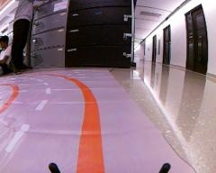
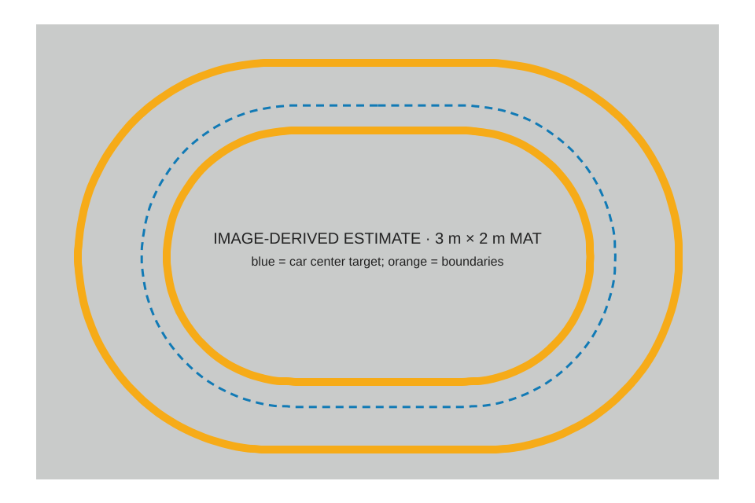

# PiRacer line follower

A Waveshare PiRacer Pro follows the inside orange tape counter-clockwise around the ESE 1110 race mat. One fisheye camera supplies both the steering target and the preview used to slow down for bends. The race is scored over ten laps, with five seconds added for leaving the track and ten for a manual reposition.

The current race controller uses **pure pursuit for steering geometry and PD for a small visual correction**. The Race preset completed a nominal simulated lap in **3.69 s**. The November 10 controller still needs a timed run on the physical car.

## Recommended run on the car

Load the current project onto the Pi, then use the three on-car presets in order. The dashboard is hosted by the Pi, so it appears when the car program is running.

1. On the Mac, connect to the Pi's Wi-Fi and run `./car.sh`. This finds the Pi, installs the checked bundle when needed, starts the car program, and opens the Pi dashboard. The car starts in Manual.
2. Place the car at the start mark. Check the live camera overlay and make sure the inside line is tracked. Choose **First slow lap**, then switch to **Full Auto** and watch the car complete the circle. Stop if it loses the line or approaches the wall.
3. If the slow lap stays on the track, select **Safe race** and run a lap. This is the intermediate speed check.
4. If Safe race also stays on the track, select **Race**. It uses the highest straight speed and a slightly lower curve speed.

The presets change the running car's settings immediately. **Save Tuning** keeps them across a program restart. To load updated code, restart the car program with `./car.sh restart`. A Pi reboot is not part of the normal code update.

## Visual guide

The overlay below is a saved test frame from the car. Orange marks the detected tape, and the blue vertical line is the image target. The live dashboard adds the current track estimate, throttle, steering and section readouts beside the video.



The track diagram is reconstructed from an image of the Waveshare mat. It helps explain the repeated semicircles and straights. Its dimensions are estimates until measured on the physical mat.



**Try the simulator on your Mac** to watch the same steering and throttle logic run against a simulated car.

```bash
python3 -m pip install -r requirements.txt -r requirements-test.txt
python3 pi/sim_dashboard.py --sim 8893
```

The local page at [localhost:8893](http://localhost:8893/) is available while the simulator runs. Its source badge explicitly identifies simulated telemetry. The car dashboard is served separately by the Pi.

For updates, connect the Mac to the Pi's Wi-Fi network and use the configured SSH key. From the repository root:

```bash
./car.sh pull     # update main and check the deployment bundle locally
./car.sh check    # check the bundle, dependencies, SSH key and tests
./car.sh          # find the Pi, install if needed, start the dashboard
```

The program starts in Manual. Dashboard **STOP** or Space returns to Manual with zero throttle. On the gamepad, A cycles modes, Y is the emergency stop, and X quits the program.

## How the steering evolved

### 1. Follow the edge with PD

OpenCV identifies the orange boundaries and tracks which one is on the left. The pilot normally follows the inside edge of the left tape. When it uses the right boundary as backup, it accounts for the lane width. The original controller reduced that view to one measurement: where the tracked edge crossed a row 62% down the image.

Let `x` be that horizontal position divided by image width. With a target of 0.40, an edge measured at 0.45 gives an error of +0.05. At KP 3.5 the proportional term asks for +0.175 steering, to the right. The derivative term responds to how fast the error is changing. The code filters it so a one-frame shift in the detected edge has less influence:

```text
error       = x − target
derivative  = 0.6 × previous_derivative + 0.4 × (error − previous_error) / dt
PD command  = KP × error + KD × derivative
```

The first derivative sample after a tracking gap is zero. Steering commands are clipped, smoothed and rate limited before reaching the servo. There is no integral term. [Steering implementation](linetrack/controller.py)

This worked well enough to drive real laps. The difficult case was entering a semicircle. A straight and a bend can put the tape at the same place on the measurement row while requiring different wheel angles. Separate straight and curve gains let the PD controller react harder once the error grew. Later revisions also used curvature to slow the car on entry. Steering still depended on the image error to build the turn. [November 9 controller history](CHANGELOG.md)

### 2. Aim at a point on the path ahead

Pure pursuit uses the **shape of the visible edge**. The pilot projects edge pixels onto the floor through the camera model. It offsets those points along the local normal to the tape, producing the path the rear axle should follow. That offset is what lets the car drive beside the tape around a circle.

The pilot chooses a goal on that path at a distance of **0.55 m + 0.30 s × estimated speed** from the rear axle. Speed comes from the previous throttle command and the model's speed table. If the tape disappears around a tight bend before reaching the requested distance, the pilot can use the farthest usable point.

For a goal at `(x, y)` metres in the vehicle frame, with x forward and y left, the curvature of the arc from the rear axle to the goal is `2y / (x² + y²)`. The required front-wheel angle is `atan(wheelbase × curvature)`. The pilot converts this angle to the servo's sign and command scale using a 0.1741 m wheelbase and an estimated 18° wheel angle at full lock. [Goal selection and steering geometry](linetrack/geometry.py)

On an ideal circular path, that construction returns the circle's curvature even when the car is already exactly on its intended path. The car can therefore hold a turn with near-zero image error. On a straight, a centered goal directly ahead gives zero curvature. Both behaviors follow from the same steering calculation.

### 3. Account for delay and correct the remaining error

At race pace the car moves between capturing the image and getting a response from the wheels. The pilot predicts **0.15 s** of motion at the estimated speed and current commanded wheel angle, then expresses the goal relative to that predicted pose. This matters most on entry and exit, where the needed wheel angle changes quickly.

The camera mount and steering calibration are approximate, so the pilot also checks the edge position in the image. In a curve it uses the model's expected edge position when available, reducing the tendency to add a second correction for a turn already handled by pursuit. The default command before output limiting is:

```text
steering = pursuit command + 0.10 × (KP × image error + KD × filtered derivative)
```

With KP 3.5 and KD 0.4, the effective visual gains during pursuit are 0.35 and 0.04. If an edge is tracked but its projected points cannot produce a goal, the controller uses full PD for that frame. An entirely lost line or stale frame goes through the pilot's motion safeguards. [Pilot and fallback logic](pi/donkey_part.py) · [Car settings](pi/line_config.py)

## Straight speed, curve entry and race presets

Throttle is scheduled separately from steering. A bend visible ahead can reduce the target before the wheels have turned far. The planner blends the straight, transition and curve targets, also slowing for a large tracking correction. It limits the rate of change and waits for a confirmed straight before returning to full straight throttle.

| Dashboard preset | Straight | Transition | Curve | Purpose |
|---|---:|---:|---:|---|
| First slow lap | 0.75 | 0.75 | 0.70 | Check camera alignment and whether the car completes the bend |
| Race | 1.00 | 0.95 | 0.90 | Fastest preset validated in the documented simulation sweep |
| Safe race | 0.92 | 0.89 | 0.86 | Lower pace if the car runs wide |
| PD fallback | 0.75 | 0.75 | 0.70 | Compare steering against the earlier PD controller |

These numbers are throttle commands. Actual lap speed depends on the battery, motor, grip and steering under load. For a curve that runs wide, check the overlay and section reading at entry. If the edge is correct but the projected goal is misplaced, check camera height and pitch first. The defaults of **0.12 m** and **15°** are estimates.

## What has been verified

The repository's historical comparison reports 8.40 s per simulated lap for the November 9 section-PD setup and about 3.7 s for the November 10 Race setup. Those runs used each revision's own throttle profile, camera model and steering settings. The improvement measures the whole setup. The comparison does not isolate how many seconds pure pursuit contributed. [Comparison and evidence](CHANGELOG.md)

The Race evaluation uses three seeds, 30 simulated seconds per seed and 21 variations, including combinations of grip, servo response and delay. The November 10 local run recorded **3.69 s nominal**, **4.32 s in the slowest variation**, and zero wide or deep-inside failures. The scorer permits riding over the inside line within its 0.10 m tolerance and reports inside-line overlap separately. A real lap timer and the race judge determine the physical result. [Evaluation criteria](tools/race_eval.py) · [Scoring implementation](tools/simdrive.py)

```bash
python3 -B -m unittest discover -s tests -q
python3 tools/race_eval.py --pairs
python3 -m sim params
python3 tools/backtest.py --frames-dir runs/<run> --dt 0.05
```

Replay checks the detector and steering decisions against previously recorded images. A different steering command would have changed the next image, so use closed-loop simulation to compare lap times and a physical trial to validate the model. The speed table, grip and camera mount are especially important measurements. [Calibration guide](sim/CALIBRATION.md)

## Racing Line default

The **Racing Line** is the dashboard's default physical setup. Pure pursuit moves a little out from the inside tape on the straights, then pulls in through each curve. Its race-day middle profile uses an apex target of **−5 cm**, straight offset **17 cm**, throttle **1.00 / 0.94 / 0.90**, and **PWM 407**. Its **13.4° Racing Line steering model** is separate from the nominal **18°** steering model used by the older Race, Safe Race, Slow, and PD presets. [Racing line](linetrack/racing_line.py)

- The planned line is magenta on the camera overlay.
- It works from either orange line and never plans a curve tighter than the car's steering lock.
- If the lane width or curve shape can't be read, ordinary pursuit steers and the dashboard says so.
- Two sliders set how hard it cuts: **Curve distance from inside tape** and **Straight distance from inside tape**.

Racing Line is the code's default Full Auto setup. **Race** is the separate older configuration (1.00 / 0.84 / 0.80 at PWM 407). A Pi-side `tuning.json` from an earlier deployment may need to be replaced by redeploying and verifying the effective dashboard settings; pushing code alone does not change the running Pi.

## Working on the car

`./car.sh status` reports the running program and installed version. Use `./car.sh restart` to install an update during a planned stop, `./car.sh log` to follow the output and `./car.sh stop` to quit. Deployment checks the exact bundle locally and refuses to install over a running drive program. The application lives in `~/linefollow` on the Pi. If a revision changes the defaults, incompatible saved tuning is moved aside so an old setting cannot silently override the new setup.

Start with the [changelog](CHANGELOG.md) for measured results and the [handoff](HANDOFF.md) for session and deployment rules. The [detector](linetrack/detector.py), [pilot](pi/donkey_part.py), [dashboard server](pi/webui.py) and [simulator](sim/) are the main entry points for development.
